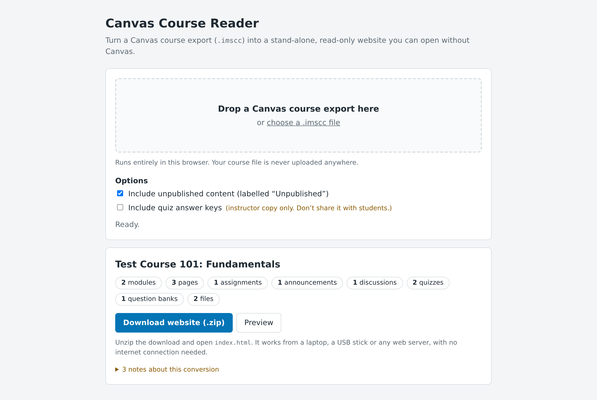
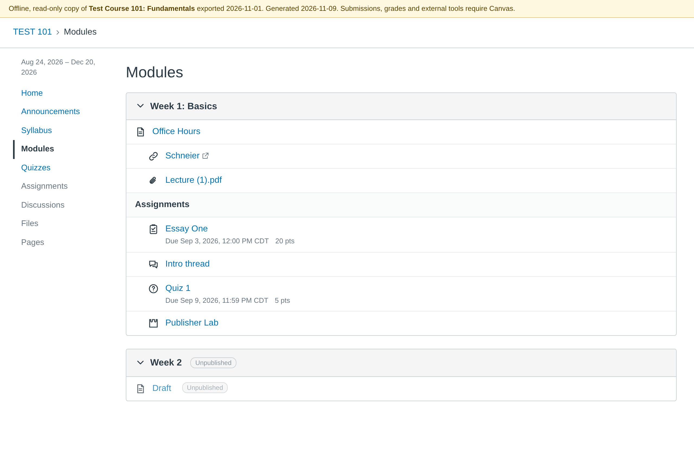

# Canvas Course Reader

Converts a Canvas LMS course export (`.imscc`) into a stand-alone, read-only static
website: a backup that faculty can open when Canvas is unavailable.

- **Converter:** one self-contained HTML file (`dist/index.html`). Open it in a browser, drop in the
  `.imscc`, preview the result, and download a ZIP. Everything runs locally. The page's CSP sets
  `connect-src 'none'`, so the browser itself prevents the course file from being uploaded.
- **Output:** plain multi-page HTML with relative links and no JavaScript. Unzip it and open
  `index.html` from disk, a USB stick, or any web server.

*The converter after loading an export.*

*A page of the generated site, opened from disk.*

Both screenshots use the synthetic test course from `test/fixture.ts`, not real course content.

> **Maintaining or extending this?** [ARCHITECTURE.md](ARCHITECTURE.md) covers building,
> testing and deploying, plus the design decisions, Canvas export quirks, security model and
> known gaps. Coding agents also get [CLAUDE.md](CLAUDE.md).

## How to use it

1. In Canvas, go to **Settings → Export Course Content → Course**, and download the `.imscc`
   when it's ready. Exports may also arrive automatically from
   [canvas-exporter](https://github.com/amikeal/canvas-exporter).
2. Open the converter (`dist/index.html`, or the hosted copy) and drop the file in.
3. Check the summary and any notes, click **Preview** to browse, then **Download website
   (.zip)**.
4. Unzip it anywhere and open `index.html`.

Don't put generated sites on a public web server. They contain copyrighted course material,
and instructor copies contain answer keys.

## What's included (and what isn't)

| Rendered | |
|---|---|
| Modules | order, indents, sub-headers, publish state, previous/next navigation |
| Pages | including the front page |
| Assignments | due dates, points, submission types, assignment groups and their weights |
| Announcements and discussions | including graded discussions |
| Files | copied byte-for-byte; PDFs open in the browser |
| Quizzes | classic quizzes, New Quizzes and question banks |
| Syllabus | with the course summary; course navigation tabs as in Canvas |
| External links | linked; LTI tools appear as "requires Canvas" stubs |

Canvas course exports never contain **student submissions, grades, rosters or discussion
replies**. Rubrics, calendar events and outcomes are reported in the conversion notes but not
rendered yet. Links to Canvas features that don't exist offline are shown as unavailable.

Due dates are shown in the instructor's time zone from the export, not the viewer's.

## Options

- **Include unpublished content** (default on): unpublished items are shown with a badge.
- **Include quiz answer keys** (default off): this produces an *instructor copy*
  (`*-instructor.zip`). QTI exports contain the correct answers, so a copy made with this
  option must not be given to students.

## Privacy and safety

- The course file is processed entirely in your browser and is never uploaded. The page's
  security policy blocks all network requests.
- Course HTML is sanitized, and generated pages can't run scripts. Embedded videos load from
  their sites when you're online.
- Files that were uploaded to the course are copied unchanged.

Details are in [ARCHITECTURE.md §5](ARCHITECTURE.md#5-security-model).
